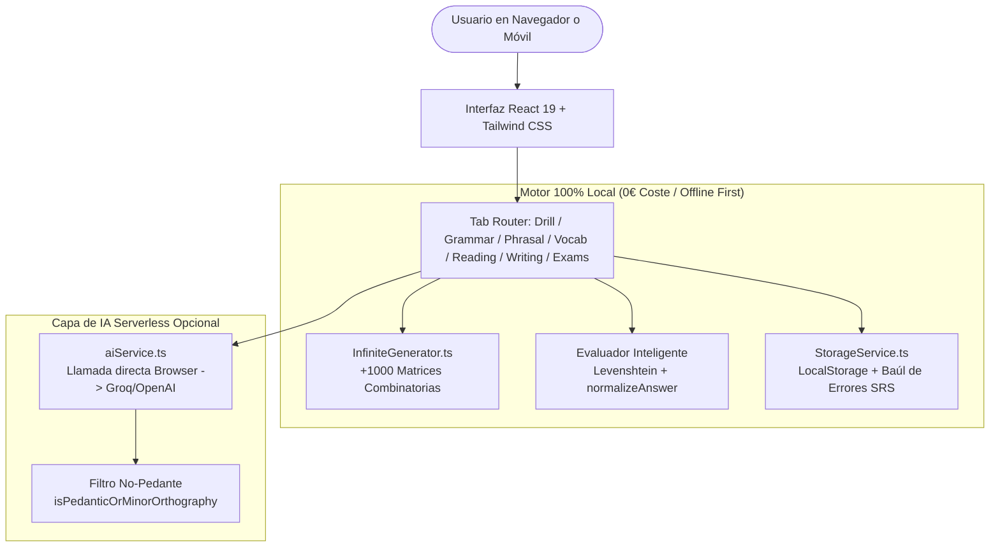

# EngDrill Pro — Arquitectura y Funcionamiento Interno del Código
> **Manual Técnico y Guía de Explicación (Niveles A2+ a B2+ Advanced)**  
> **Versión:** 5.0.0 (Release Non-Pedantic) | **Fecha:** Octubre 2026  
> **URL en Producción:** [https://adriansg25.github.io/aprende-en/](https://adriansg25.github.io/aprende-en/)  
> **Repositorio Oficial:** [https://github.com/adrianSG25/aprende-en](https://github.com/adrianSG25/aprende-en)  
> **Archivo PDF descargable:** `EngDrill_Pro_Arquitectura_y_Codigo.pdf` (en la raíz de este proyecto)

---

## 1. Visión General y Filosofía de Diseño

La gran mayoría de las apps de idiomas del mercado (Duolingo, Babbel, etc.) están enfocadas en niveles iniciales (A0–A1), utilizan mecánicas pasivas con personajes infantiles y consumen la mayor parte del tiempo en ejercicios de escucha elemental. Para un estudiante hispanohablante que ya tiene una base (A2) y busca consolidar el **B1 y B2 avanzado** de Cambridge (Linguaskill / First / IELTS 6.5), ese método resulta ineficaz y frustrante.

**EngDrill Pro** nació con una filosofía radicalmente diferente:
1. **0% tiempo pasivo en audios:** Las series y podcasts en versión original cubren la comprensión auditiva natural. La app se enfoca al 100% en la **producción activa y la fijación de patrones mediante memoria muscular de tecleo y repetición intensiva**.
2. **Desactivación de los errores típicos de hispanohablantes:** En lugar de ejercicios genéricos, se centra en trampas clásicas como *"I am agree"*, *"married with"*, *"explain me"*, o la confusión entre *"despite"* e *"in spite of"*.
3. **Inmediatez absoluta (< 5 ms):** Evaluación instantánea de cada respuesta en el cliente con detección de diferencias palabra por palabra (*diff* rojo/verde) y explicación de la regla gramatical en español.
4. **Simulaciones de la vida real ("¿Qué le responderías?"):** Escenarios prácticos (en el taller mecánico, reclamación con el casero, aeropuerto, entrevistas de trabajo) donde el usuario redacta libremente y la IA evalúa su respuesta sin pedantería.

---

## 2. Arquitectura Global del Sistema

EngDrill Pro es una **Single Page Application (SPA) / Progressive Web App (PWA)** construida con:
- **React 19** + **TypeScript estricto**
- **Vite 8** (compilador y empaquetador ultrarrápido)
- **Tailwind CSS v4** (estilos utilitarios modernos y modo oscuro)
- **Service Worker v5** + **Web App Manifest** (PWA instalable offline)



### ¿Por qué esta arquitectura es una ventaja clave?
- **Cero costes de servidor (0 €/mes):** No requiere un servidor backend en Node o Python encendido continuamente. Los archivos estáticos se sirven a través del CDN mundial de GitHub Pages. Puede atender a decenas de miles de usuarios sin saturarse ni generar costes.
- **Privacidad absoluta:** El progreso, las estadísticas, el historial de fallos y las claves API se guardan **únicamente en el almacenamiento local (`localStorage`) del dispositivo del usuario**.
- **Disponibilidad Offline:** Gracias al `Service Worker`, todos los ejercicios locales funcionan sin internet (en el metro, en un avión o sin cobertura móvil).

---

## 3. El Motor de Evaluación y Tolerancia Ortográfica

Uno de los mayores dolores de cabeza de los estudiantes con las plataformas convencionales es la **pedantería ortográfica**: marcar fallo si no pones un guion (`second-hand` vs `second hand`), si omites un apóstrofe al escribir rápido en el móvil (`dont` vs `don't`), o si cometes una errata de una letra al pulsar el teclado.

En EngDrill Pro implementamos un motor de evaluación en dos niveles:

### Nivel 1: Normalización Lingüística Local (`normalizeAnswer`)
Ubicado en [`src/data/infiniteGenerator.ts`](file:///c:/Users/adria/OneDrive/Escritorio/Aprende_EN/src/data/infiniteGenerator.ts):
- **Tratamiento de guiones:** Todos los guiones (`-`, `–`, `—`, `_`) se convierten a espacios simples. Escribir `second hand`, `well known` o `full time` es 100% idéntico a su variante con guion.
- **Expansión tolerante de contracciones:** `dont` ➔ `don't`, `cant` ➔ `can't`, `ive` ➔ `i've`, `im` ➔ `i'm`, `wont` ➔ `won't`.
- **Eliminación de puntuación periférica y normalización de espacios:** Se eliminan puntos, comas y comillas accidentales.

### Nivel 2: Coincidencia Difusa con Distancia Levenshtein (`checkAnswerMatch`)
Si el usuario escribe una palabra larga (≥ 5 letras) con un desliz de teclado de 1 carácter (por ejemplo, `responsable` en vez de `responsible`, o `expalined` en vez de `explained`), el motor lo reconoce, lo da por válido y muestra la corrección visual en pantalla para que el usuario sea consciente del detalle sin frustrarse.

---

## 4. El Generador Infinito de Ejercicios (Sin IA / Cero Coste)

Ubicado en [`src/data/infiniteGenerator.ts`](file:///c:/Users/adria/OneDrive/Escritorio/Aprende_EN/src/data/infiniteGenerator.ts):
En lugar de depender de llamadas lentas y de pago a modelos de lenguaje para cada pregunta, el sistema combina:
1. **Banco Estático Curado:** Cientos de ejercicios diseñados con estándar Cambridge Use of English.
2. **Matrices Procedimentales Dinámicas:** Generadores que combinan sujetos, tiempos verbales, preposiciones dependientes y transformaciones.
3. **Barajado Fisher-Yates:** Mezcla aleatoria que garantiza colas infinitas sin repeticiones consecutivas.

| Tipo de Ejercicio | Identificador en Código | Utilidad Pedagógica |
| :--- | :--- | :--- |
| **Cloze / Relleno de Hueco** | `type: 'cloze'` | Preposiciones dependientes (*accused of*, *congratulate on*) y partículas. |
| **Corrección de Errores** | `type: 'error_correction'` | Detección de trampas clásicas de hispanohablantes (*I am agree* ➔ *I agree*). |
| **Transformación de Oraciones** | `type: 'transformation'` | Ejercicio Cambridge Part 4: Reescribir con una palabra clave (ej. *AS*). |
| **Formación de Palabras** | `type: 'cloze'` con raíz léxica | Cambridge Part 3: Modificación de sufijos/prefijos (*SUCCEED* ➔ *success*). |

---

## 5. Capa de Inteligencia Artificial Serverless (IA Opcional)

Ubicada en [`src/services/aiService.ts`](file:///c:/Users/adria/OneDrive/Escritorio/Aprende_EN/src/services/aiService.ts):
Permite al usuario activar IA si lo desea (usando su clave gratuita de Groq o de OpenAI) para redacción libre, generación de historias B1/B2 a medida y simulaciones de rol.

### Características Técnicas de la Integración con IA:
1. **Auto-descubrimiento de modelos en vivo (`fetchAvailableModelsForKey`):** Consulta directamente el endpoint `/v1/models` para listar únicamente los modelos de chat actualmente activos en la cuenta del usuario, eliminando los fallos `404 model_not_found`.
2. **Filtro de seguridad contra pedantería (`isPedanticOrMinorOrthography`):**
   - El *prompt* del sistema ordena al LLM ignorar guiones, comas y mayúsculas.
   - En TypeScript, el código procesa los errores devueltos por el JSON de la IA. Si la IA incluye un fallo pedante (como `second hand` ➔ `second-hand`), **el código lo elimina de la lista y recalcula la nota al alza automáticamente**.
3. **Modo Situaciones de la Vida Real ("¿Qué le responderías?"):**
   - El interlocutor (ej. mecánico o casero) plantea una situación.
   - El usuario responde con sus propias palabras.
   - La IA le indica qué errores gramaticales reales ha cometido, cómo un nativo B2+ diría esa misma frase de forma más fluida, y **le genera la réplica de respuesta del personaje** para continuar el diálogo.

---

## 6. Persistencia y Repetición Espaciada (SRS)

Ubicada en [`src/services/storageService.ts`](file:///c:/Users/adria/OneDrive/Escritorio/Aprende_EN/src/services/storageService.ts):
El objetivo de la app es el dominio definitivo, no acertar de casualidad.

- **El Baúl de Errores (`MistakeVault`):** Cada vez que el usuario comete un error, el ejercicio se guarda en una cola prioritaria en `localStorage`.
- **La Regla de las 3 Victorias Consecutivas:** Un ejercicio solo se marca como dominado (`mastered: true`) cuando el usuario lo acierta **3 veces seguidas** en sesiones posteriores. Si a la segunda victoria vuelve a fallar, el contador vuelve inmediatamente a cero.
- **Racha Diaria (Streak):** Monitoriza la constancia día a día comparando la fecha ISO de actividad con el día anterior.

---

## 7. Estructura de Ficheros del Proyecto

```
c:\Users\adria\OneDrive\Escritorio\Aprende_EN\
├── public/
│   ├── manifest.json            # Configuración PWA (iconos, standalone, tema)
│   ├── sw.js                    # Service Worker v5 (caché y offline first)
│   └── icon.svg                 # Icono oficial vectorizado
├── src/
│   ├── types/
│   │   └── index.ts             # Modelos de datos TypeScript (Exercise, Level, Stats...)
│   ├── services/
│   │   ├── storageService.ts    # Persistencia en LocalStorage + Algoritmo SRS
│   │   └── aiService.ts         # Integración LLM + Auto-descubrimiento + Filtro No-Pedante
│   ├── data/
│   │   ├── infiniteGenerator.ts # Generador procedimental + Motor Levenshtein
│   │   ├── grammarData.ts       # Teoría y matrices de gramática A2+ a B2+
│   │   ├── phrasalVerbsData.ts  # 60+ Phrasal verbs con la lógica de la partícula
│   │   ├── vocabularyData.ts    # Word formation, preposiciones dependientes y collocations
│   │   ├── readingData.ts       # Historias interactivas y análisis "Rayos X"
│   │   └── writingData.ts       # Escenarios de Roleplay y ensayos guiados B2
│   ├── components/
│   │   ├── App.tsx              # Componente principal y navegación por pestañas
│   │   ├── ExerciseCard.tsx     # Renderizador de ejercicios con diff visual y traducción
│   │   ├── DrillArena.tsx       # Arena de práctica infinita y Baúl de Errores
│   │   ├── GrammarZone.tsx      # Zona de estudio gramatical estructurado
│   │   ├── PhrasalVerbsZone.tsx # Zona de phrasal verbs
│   │   ├── VocabZone.tsx        # Zona de vocabulario
│   │   ├── ReadingZone.tsx      # Zona de lectura comprensiva y preguntas abiertas
│   │   ├── WritingZone.tsx      # Zona de "¿Qué le responderías?" y redacción guiada
│   │   ├── ExamZone.tsx         # Simulador de exámenes Cambridge B1/B2
│   │   └── SettingsModal.tsx    # Configuración de clave IA y selección de modelo
│   ├── main.tsx                 # Entrada de React y registro del Service Worker
│   └── index.css                # Estilos globales de Tailwind CSS
├── scripts/
│   └── generate_doc_pdf.cjs     # Script para generar el PDF con Microsoft Edge
├── package.json                 # Dependencias y scripts de compilación
├── vite.config.ts               # Configuración de Vite
└── EngDrill_Pro_Arquitectura_y_Codigo.pdf # Documento PDF oficial maquetado
```

---

## 8. Cómo Explicar el Proyecto en 2 Minutos (El "Pitch")

Cuando un amigo, compañero de trabajo, profesor o entrevistador te pregunte cómo funciona la app, puedes explicárselo con este guion:

> *"Es una Progressive Web App construida en **React 19 y TypeScript** diseñada para consolidar el paso del nivel A2 al B2 avanzado de Cambridge.
>
> A diferencia de las apps convencionales tipo Duolingo que se enfocan en audios básicos para principiantes, esta está orientada a **machacar gramática compleja, phrasal verbs y redacción en situaciones reales de trabajo**.
>
> Por dentro tiene una arquitectura **client-side first**:
> 1. Un generador combinatorio con más de mil ejercicios que corre en el navegador a **cero coste y en menos de 5 milisegundos**.
> 2. Un sistema de **repetición espaciada** que te obliga a acertar cada fallo 3 veces seguidas para darlo por superado.
> 3. Un motor de **tolerancia ortográfica** que no te castiga por tonterías como omitir un guion (`second hand` vs `second-hand`) o un apóstrofe al teclear en el móvil.
> 4. Una capa de **Inteligencia Artificial serverless** opcional que te evalúa cuando redactas respuestas libres en situaciones de la vida real (como hablar con un mecánico o un casero en inglés) y te muestra cómo lo diría un nativo."*

---

## 9. Despliegue y Distribución

1. **Compilación:** `npm run build` ejecuta el comprobador de tipos de TypeScript (`tsc -b`) y empaqueta el código minificado con Vite en la carpeta `dist/`.
2. **Hosting en GitHub Pages:** El contenido de `dist/` se publica directamente en la rama `gh-pages` del repositorio `adrianSG25/aprende-en`.
3. **Instalación en el Móvil:**
   - En **iOS (Safari):** Abrir el enlace ➔ Botón *Compartir* ➔ *Añadir a pantalla de inicio*.
   - En **Android (Chrome):** Abrir el enlace ➔ Menú de 3 puntos ➔ *Instalar aplicación* o *Añadir a pantalla de inicio*.
   - La aplicación se abre a pantalla completa, sin barras de navegación, exactamente igual que una app nativa descargada de la tienda.
